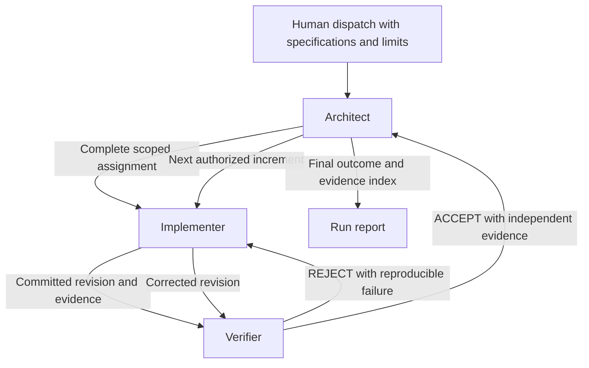

# Tablekeeper factory

**Status: native Codex development/preflight run active; Band Desktop submission provenance pending.** The compliance add-on is being executed by three actual Codex seats. The root product remains separate from stage submissions. This document does not claim that Band Desktop seats ran or that a Band room was exported. Current scope, gates and blockers are in [add-on execution](docs/addon/EXECUTION.md).

## Actual topology

| Seat | Role | Harness/tool | Effective model | Responsibility |
| --- | --- | --- | --- | --- |
| `/root` | Architect | Codex CLI 0.159.2 / VS Code and native collaboration | `gpt-6.1-sol` | Specification pinning, complete assignments, environment, integration and evidence |
| `/root/addon_implementer` | Implementer | Codex CLI 0.159.2 / native collaboration | `gpt-6.1-sol` | Complete stage source, tests, packaging and repair commits |
| `/root/addon_reviewer` | Independent Reviewer/QA | Codex CLI 0.159.2 / native collaboration | `gpt-6.1-sol` | Exact-revision independent review, isolated official harness and adversarial checks |

Metadata was read from actual runtime session records; see [metadata evidence](docs/addon/runtime-metadata.json). These session identities are native Codex seats and are not presented as Band identities. The generic mandates are [architect](mandates/architect.md), [implementer](mandates/implementer.md), and [reviewer](mandates/reviewer.md). The verifier mandate is retained for the original kit's role alias.

## Intent

Build a reusable software-production process whose implementation and independent verification are visible in a BAND room. Success means an accepted revision has traceable requirements, executable evidence, and an explicit verifier decision. A blocked run reports its last proven outcome honestly.

The selected track is Tablekeeper. All three current seats use Codex and the observed model above. A later Band setup must independently verify its own effective runtime metadata before dispatch.

## Architecture

| Seat | Owns | Boundary |
| --- | --- | --- |
| Architect | Specification mapping, design decisions, assignments, integration order, run report | Does not replace independent verification or become the primary application author |
| Implementer | Application changes, regression tests, packaging, repair commits | Cannot accept their own work |
| Verifier | Independent specification review, checks, browser exercise, rejection/acceptance | Does not silently repair the application under review |

The final submitted factory requires three distinct Band Desktop identities. Those identities are not configured in this preflight run. Runtime metadata for the current native seats is recorded separately; a final Band roster must come from its actual configured seats.

## Why this design

Three differentiated seats give each decision an owner without adding coordination roles. A single writer for the shared result checkout prevents Git index collisions. The Verifier tests a separate checkout of an immutable revision, so later edits cannot invalidate what was actually tested.

An alternative is one branch and worktree per role, with an integration seat merging every contribution. That permits more simultaneous coding but adds merge handling. Another alternative is a fourth specialist for interface work; this kit defers it until a rehearsal demonstrates a bottleneck. The initial design favors a small, inspectable coordination loop.

## Task and evidence flow

The Architect reads each specification, assigns stable requirement IDs, and develops a requirement-to-evidence matrix. Domain facts live in the task and resulting design artifacts, never in mandates. Every delegated message contains the complete task and relevant cumulative specification, plus revision, write scope, commands, and expected evidence.

The Implementer returns a full commit SHA and local check results. The Verifier independently reads the requirements, runs checks on that SHA, and posts ACCEPT, REJECT, or BLOCKED. The Architect validates coverage and records the outcome. See [Handoffs](docs/HANDOFFS.md) for exact fields.

## Repository and stage progression

The starter kit, official challenge checkout, result repository, and scratch verification checkouts are separate. Only the result repository is the application submission. [Repository workflow](docs/REPOSITORY.md) defines the layout and exclusive writer protocol.

The factory works incrementally. It preserves an accepted earlier folder and extends a copy for the next authorized stage. The [run plan](docs/RUN-PLAN.md) covers all four stages. Earlier accepted folders are rechecked if a defect could affect them; a new commit invalidates affected previous acceptance decisions until reverified.

## Acceptance policy

Acceptance requires the named revision to satisfy its specification, independent checks, reproducible packaging, and the relevant earlier requirements. Passing visible checks is useful evidence, but cannot substitute for specification coverage. Expected next-stage probe failures are separated from failures of required behavior.

The internal quality target is all applicable shipped checks passing and no known specification violation. This is a factory quality policy, not a statement that the organizers' scoring threshold is identical.

## Failure handling

- A reproducible functional defect returns to the Implementer with expected and actual behavior and a regression-test request.
- Missing handoff context returns to the sender; no seat guesses a missing acceptance criterion.
- A changed revision, incomplete check, skipped suite, or missing browser invalidates acceptance evidence.
- An infrastructure failure gets one bounded retry after an observable environment correction. Repeated blind reruns are not a repair strategy.
- After the configured repair limit or time budget, the Architect reports BLOCKED or PARTIAL with the last accepted stage, failing evidence, and remaining work.

Limits are supplied before dispatch. Seats resolve choices among themselves using the specification. They do not wait for human approval mid-run. Existing platform permissions still apply; an unavailable required permission is recorded as an infrastructure blocker.

## Measurements

Use [the run record](templates/run-record.md). Record UTC start/end times, elapsed wall time, runtime/model versions, full revision IDs, requirement coverage, failure/repair links, and per-seat usage sources. Sum billed model costs in a single declared currency. If only token counts or estimates are available, label them as estimates; unavailable usage is unknown, not zero. Subscription allocation is reported separately from incremental provider charges.

| Measurement | Current value |
| --- | --- |
| BAND room / seat IDs | Not configured |
| Official challenge revision | `803560d2a678ace1414465c098eb0ab5380ffade`; local clean checkout matches upstream main |
| Completed stages | Historical native Stage 1 acceptance at `b18c6c0aed4086bb33458e27f47b8c8c5187db5b`; a later contract finding requires renewed acceptance. Eligible Band-submitted stages: none |
| Harness outcomes | Historical Stage 1 retest: 120/120 official isolated, 13/13 independent, 10/10 internal; subsequent empty-display-name finding under repair. Stage 2 being implemented |
| Elapsed factory runtime | Actual first native dispatch `2026-10-03T04:44:04.115Z`; elapsed ongoing snapshot in [run progress](docs/addon/run-progress.json), not a final Band duration |
| Model cost | Not measured |
| Failure/repair episode | Actual Stage 1 REJECT, generalized fix, new commit and independent ACCEPT. See [independent decisions](docs/addon/REVIEWS.md) |

## Reproduction and limitations

Follow [Setup](docs/SETUP.md), use the same resolved mandates and dependency versions, provide the same pinned specifications, and dispatch the same completed task. Record any environmental difference. Model outputs need not be byte-for-byte deterministic; reproducibility here means another operator can configure and evaluate the same process.

The current native collaboration runs implementation and independent review, while Band Desktop remains required for final eligible provenance. Docker was installed and started in WSL Ubuntu; the official harness uses Python 3.12+ in a separate environment. Each stage includes its own lockfile and runtime so builds do not depend on the root product's installed packages or private files. A clean clone and isolated harness run must confirm this for every stage claimed.

Model costs and final Band factory duration are unavailable; no value is invented. Native preflight elapsed wall time is measured from the actual dispatch and labeled as an ongoing snapshot. Actual cumulative native session token telemetry is preserved in the metadata file with explicit limits: root totals include earlier development, children may inherit context, and these values are not summed into add-on usage or converted into an invented charge. Context truncation, model/provider limits, inaccessible paths, long container builds, and shared machine contention remain practical failure risks. A final Band rehearsal must prove full handoff delivery, independent execution, and genuine room export before the submitted run.

## Event references

Use the [official participant guide](https://github.com/band-ai/dark-factory-wearedevs/blob/main/docs/participant-guide.md) for eligibility and harness behavior, and the [event page](https://lablab.ai/ai-hackathons/wearedevelopers-hackathon) for submission details. This blueprint supplements those sources; it does not replace them.
